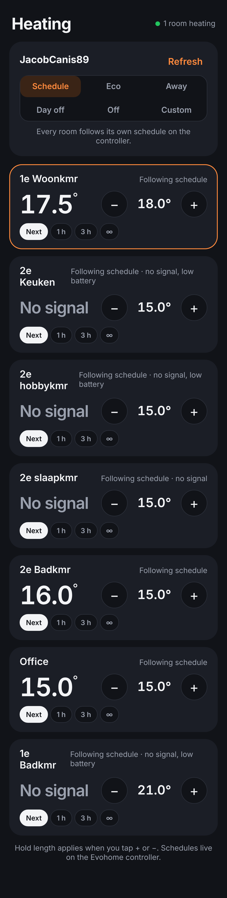
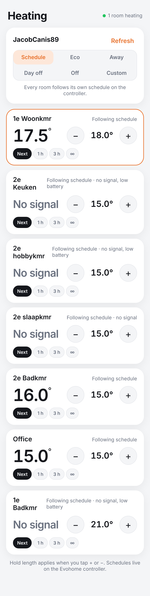

# Heating

Control your home heating from your iPhone. A small Node server runs on a
computer at home (Raspberry Pi, NAS, old laptop, Home Assistant box) and
talks to your heating. Your iPhone opens a web app that you add to the home
screen, so it looks and feels like a native app without going through the
App Store.

<p align="center">
  
  
</p>

Single-zone backends (simulator, Shelly, Home Assistant) get a dial view instead:
`docs-screenshot-dark.png` / `docs-screenshot-light.png`.

## What it does

- Big temperature dial with **+ / −** to set the target (0.5 °C steps)
- **Off / Schedule / Manual** modes
- **Boost** for 30 min, 1 h or 2 h, then back to whatever you were doing
- Weekly **schedule** editor (time, days, temperature), saves as you edit
- Works on your home Wi-Fi; optional **PIN** so guests can't change things
- Dark mode, iPhone safe areas, installs as a home-screen app
- Pluggable **drivers** so it fits different heating hardware

## Quick start (no hardware yet)

Requires Node 18 or newer. There are no dependencies to install.

```bash
cp .env.example .env
npm start
```

Open `http://<computer-ip>:3000` in Safari on your iPhone, tap the **Share**
button, then **Add to Home Screen**. Set `HEATING_DRIVER=simulator` in `.env` to try the app against a
simulated room before connecting anything.

## Connecting your heating

Edit `.env` and set `HEATING_DRIVER`.

### Honeywell Evohome (Total Connect Comfort, Europe)

This is the default. It uses the same cloud API as the Honeywell Home app,
so nothing extra needs installing at home.

```
HEATING_DRIVER=evohome
EVOHOME_USERNAME=you@example.com
EVOHOME_PASSWORD=your-tcc-password
```

The app then shows the **house mode** (Schedule, Eco, Away, Day off, Off,
Custom) and a card per room with its current temperature, its target, and
**+ / −** to override. The chips under each room choose how long an
override lasts:

| Chip  | Meaning                                                       |
| ----- | ------------------------------------------------------------- |
| Next  | until the room's next scheduled switch point (controller default) |
| 1 h / 3 h | for that long, then back to schedule                      |
| ∞     | permanent hold until you tap **Follow schedule**              |

Room schedules stay on the Evohome controller, exactly as before. Rooms
whose sensor has lost contact show **No signal**. The Honeywell cloud is rate
limited, so readings refresh every 90 s and immediately after any change.
A login token is cached in `data/evohome-token.json`.

### Option A: you have a smart thermostat (Tado, Nest, Hive, Honeywell, Netatmo, Wiser, Viessmann, Bosch…)

Use the `homeassistant` driver. Home Assistant already speaks to all of these.

1. Install Home Assistant and add your thermostat integration.
2. In Home Assistant, go to your profile and create a **Long-Lived Access Token**.
3. Find your climate entity id (Settings → Devices → your thermostat), e.g. `climate.living_room`.
4. In `.env`:

```
HEATING_DRIVER=homeassistant
HA_URL=http://homeassistant.local:8123
HA_TOKEN=paste-your-token
HA_ENTITY=climate.living_room
```

The app then sends target temperature and on/off to Home Assistant and reads
the current temperature and heating state back from it. Scheduling and boost
are handled by this app.

### Option B: a plain boiler or pump switched by a relay (Shelly)

Use the `shelly` driver. A Shelly 1 / Plus 1 / 1PM wired to the boiler's
room-thermostat terminals turns the heating on and off. The app itself acts
as the thermostat with 0.3 °C hysteresis.

```
HEATING_DRIVER=shelly
SHELLY_URL=http://192.168.1.50
SHELLY_TEMP_SOURCE=shelly          # Shelly Plus add-on temperature sensor
```

If your temperature comes from somewhere else (a Zigbee sensor via another
bridge, an ESP sensor, etc.), point at any JSON endpoint:

```
SHELLY_TEMP_SOURCE=url
SHELLY_TEMP_URL=http://192.168.1.60/sensor
SHELLY_TEMP_PATH=temperature       # dotted path into the JSON
```

> Wiring a relay to a boiler involves mains voltage. Have an electrician do
> it if you are not comfortable with that.

### Option C: something else

Add a file under `server/drivers/` that exports `createDriver(env)` returning:

```js
{
  name: 'my-heating',
  kind: 'relay',                         // or 'thermostat'
  async read() { return { currentTemp, heating /*, targetTemp */ }; },
  async setHeating(on) {},               // kind: 'relay'
  async apply({ targetTemp, mode }) {},  // kind: 'thermostat' (mode is 'off' | 'heat')
}
```

Register it in `server/drivers/index.js`. Tasmota, ESPHome, KNX, Modbus,
OpenTherm gateways and the like all fit this shape.

## Where to run the server

Because the Evohome driver talks to Honeywell's cloud, the server does not
have to be in your house. Pick whichever is easier:

**A computer at home that stays on** (Mac, Windows PC, Raspberry Pi, NAS).
Install Node from https://nodejs.org, unzip this folder, create `.env`,
run `npm start`, and open `http://<that computer's IP>:3000` on the iPhone
while on the same Wi-Fi. Add Tailscale to both devices to use it from anywhere.

**A small cloud host** (Render, Railway, Fly.io, any VPS). Use the included
`Dockerfile`, set the `EVOHOME_USERNAME`, `EVOHOME_PASSWORD` and
`HEATING_PIN` environment variables in the host's dashboard, and open the
HTTPS address the host gives you. Mount persistent storage at `/app/data`
if the host offers it, so the login token survives restarts.

## Using it away from home

The server listens on your home network only. To control the heating from
anywhere, either:

- install **Tailscale** on the home computer and your iPhone (simplest, private, free for personal use), or
- expose it through a reverse proxy with HTTPS and set `HEATING_PIN`.

Do not forward port 3000 straight to the internet without HTTPS and a PIN.

## Running it permanently

On a Raspberry Pi or Linux box:

```bash
sudo tee /etc/systemd/system/heating.service > /dev/null <<EOT
[Unit]
Description=Heating control
After=network-online.target

[Service]
WorkingDirectory=$(pwd)
ExecStart=$(command -v node) server/index.js
Restart=always
User=$USER

[Install]
WantedBy=multi-user.target
EOT
sudo systemctl enable --now heating
```

## API

All endpoints return the full state. Send `X-Pin` if a PIN is set.

| Method | Path            | Body                                   |
| ------ | --------------- | -------------------------------------- |
| GET    | `/api/state`    |                                        |
| POST   | `/api/target`   | `{ "targetTemp": 21 }`                 |
| POST   | `/api/mode`     | `{ "mode": "off" \| "auto" \| "heat" }` |
| POST   | `/api/boost`    | `{ "minutes": 60, "temp": 23 }`        |
| PUT    | `/api/schedule` | `{ "schedule": [{ "days": [1,2,3,4,5], "time": "06:30", "temp": 21 }] }` |

Days are 0 (Sunday) to 6 (Saturday). State is saved to `data/state.json`.

With the Evohome driver the endpoints are instead:

| Method | Path                         | Body                                              |
| ------ | ---------------------------- | ------------------------------------------------- |
| GET    | `/api/state`                 |                                                   |
| POST   | `/api/zones/{id}/target`     | `{ "temp": 21, "hold": "next" \| "permanent" \| minutes }` |
| POST   | `/api/zones/{id}/schedule`   | (back to the controller schedule)                 |
| POST   | `/api/house`                 | `{ "mode": "Auto" \| "AutoWithEco" \| "Away" \| "DayOff" \| "HeatingOff" \| "Custom", "minutes": 1440 }` |
| POST   | `/api/refresh`               | (force a fresh read from the Honeywell cloud)     |

## Project layout

```
server/index.js          HTTP server, API, thermostat + schedule loop
server/state.js          persisted settings, schedule resolution
server/drivers/          evohome (Honeywell), homeassistant, shelly, simulator
public/                  the iPhone web app (HTML, CSS, JS, manifest, service worker)
```
